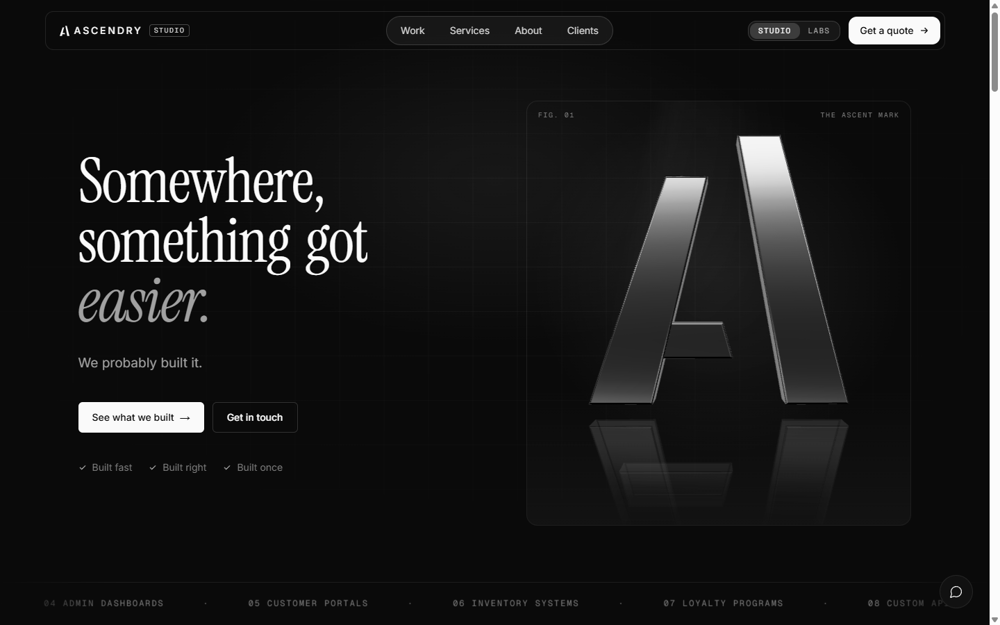
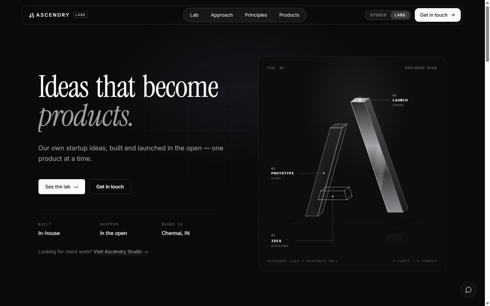
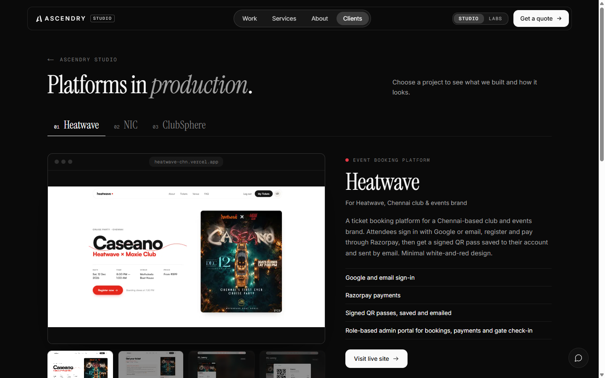
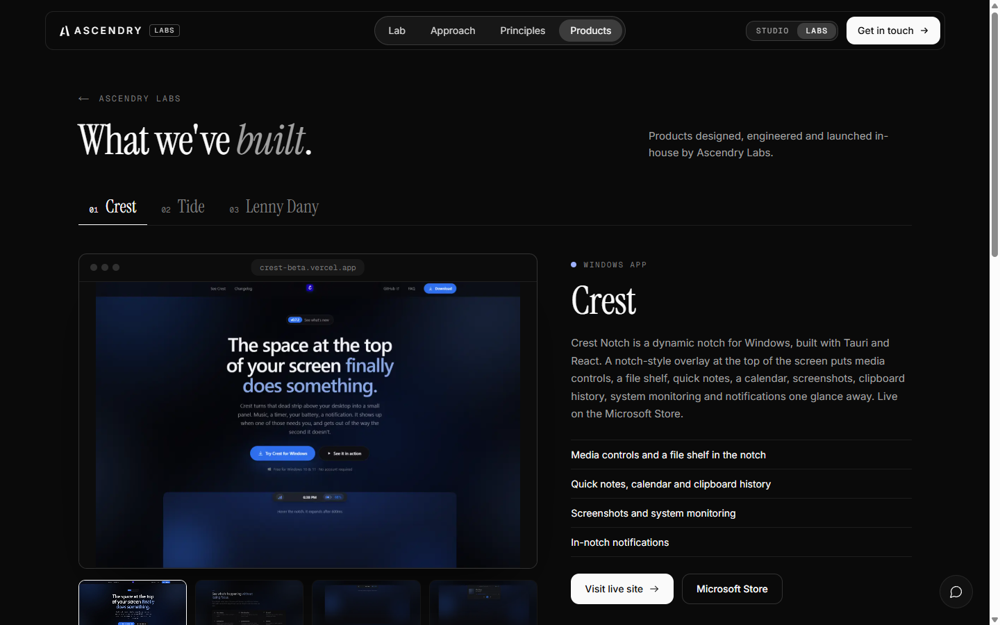

<div align="center">


# Ascendry

**Ascendry Studio** builds websites and platforms for businesses.
**Ascendry Labs** builds and launches its own products.

Chennai, India · [ascendry.vercel.app](https://ascendry.vercel.app)


</div>



## Two sites, one codebase

The site switches between two brands from the header toggle. Both share the same design system, the "Split Summit" **A** mark, dark theme and typography.

| | Studio | Labs |
| --- | --- | --- |
| Route | `/` | `/labs` |
| Purpose | Client work: websites, platforms, demos | In-house products and experiments |
| Highlights | 3D hero mark, selected work, services, clients | Lab, approach, principles, products |



## Pages

| Route | What it is |
| --- | --- |
| `/` | Studio home: hero, work, services, about, contact. The **Shipped for clients** cards open a detail popup. |
| `/clients` | Client projects. Pick Heatwave, NIC or ClubSphere and see the screens, summary and highlights in one view. |
| `/labs` | Labs home. |
| `/labs/products` | Products built by Ascendry Labs: Crest, Tide and the portfolio. |
| `/legal/[slug]` | Privacy policy, terms and conditions, refund and cancellation. |

### Clients

Platforms built and shipped for clients.

| Project | What it is | Live |
| --- | --- | --- |
| **Heatwave** | Ticket booking for a Chennai club and events brand: Google or email sign-in, Razorpay payments, signed QR passes and a role-based admin portal for gate check-in. | [heatwave-chn.vercel.app](https://heatwave-chn.vercel.app/) |
| **NIC** | Official site of NextGen Intelligence Club, SRM IST: GSAP ScrollTrigger cyberpunk animation, event registrations, admin dashboard and crew management. Ran Genesis’26 with 13 events. | [nic-srm.vercel.app](https://nic-srm.vercel.app/) |
| **ClubSphere** | Event hosting platform for college students: clubs publish campus events and manage registrations, students discover and sign up. | [vdpclubsphere.vercel.app](https://vdpclubsphere.vercel.app/) |



### Labs products

| Product | What it is | Live |
| --- | --- | --- |
| **Crest** | Dynamic notch for Windows, built with Tauri and React. Media controls, file shelf, notes, calendar, clipboard history and system monitoring. On the Microsoft Store. | [crest-beta.vercel.app](https://crest-beta.vercel.app/) |
| **Tide** | Offline-first habit tracker built in Flutter, free with no payments. | [get-tide.vercel.app](https://get-tide.vercel.app/) |
| **Portfolio** | Portfolio of Lenny Dany Derek D, solo full-stack, desktop and AI/ML engineer. | [lennydany3.tech](https://www.lennydany3.tech/) |



## Tech stack

- [Next.js 16](https://nextjs.org) (App Router, Turbopack, Cache Components)
- React 19 and TypeScript
- Tailwind CSS 4
- [Motion](https://motion.dev) for animation and [Three.js](https://threejs.org) for the 3D hero mark

## Getting started

```bash
npm install
npm run dev
```

Open [http://localhost:3000](http://localhost:3000).

| Script | Does |
| --- | --- |
| `npm run dev` | Start the dev server |
| `npm run build` | Production build |
| `npm run start` | Serve the production build |
| `npm run lint` | Run ESLint |

> This project uses a Next.js version with breaking changes. See [AGENTS.md](AGENTS.md) and `node_modules/next/dist/docs/` before changing framework-level code.

## Project structure

```
app/                  Routes: /, /clients, /labs, /labs/products, /legal
components/
  clients/            Project viewer, screenshot switcher, home-page popup
  hero/ sections/     Studio home sections
  labs/ labs-loader/  Labs pages and loader
  layout/ ui/         Header, footer, shared UI and the logo mark
  legal/              Legal pages
lib/
  clients.ts          Client projects (content and screenshots)
  products.ts         Labs products (content and screenshots)
  site.ts             Contact details used across the site
public/images/
  studio/             Client project screenshots
  labs/               Product screenshots
docs/                 README assets
```

## Editing content

- **Add or change a client project:** edit [lib/clients.ts](lib/clients.ts) and add screenshots under `public/images/studio/<project>/`.
- **Add or change a Labs product:** edit [lib/products.ts](lib/products.ts) and add screenshots under `public/images/labs/<product>/`.
- **Contact details:** [lib/site.ts](lib/site.ts).

Both lists use the same shape, so the same viewer renders them on `/clients`, `/labs/products` and the home-page popup.

## Contact

Ascendry · 3rd Block 1st Street, Kannadasan Nagar, Chennai 600118, Tamil Nadu, India
WhatsApp [+91 90435 56745](https://wa.me/919043556745) · Udyam UDYAM-TN-02-0445785
